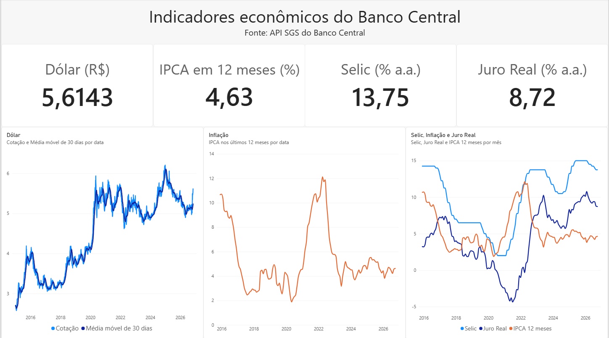
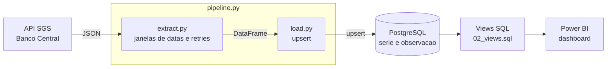

# Pipeline de indicadores econômicos do Banco Central

Pipeline de dados que extrai o dólar, a meta Selic e o IPCA da API pública do Banco Central, carrega em PostgreSQL de forma incremental e entrega views analíticas para um dashboard no Power BI.



O cartão do dólar mostra a última cotação diária. Os outros três mostram o último mês com IPCA publicado.

## O problema

Dólar, Selic e inflação são dados públicos, mas chegam como séries separadas e brutas: para cada indicador, uma lista de datas e valores em texto. Para responder a uma pergunta como "quanto os juros estão rendendo acima da inflação?", é preciso coletar as três séries, guardar o histórico, mantê-lo atualizado e cruzar os dados.

Este projeto automatiza esse caminho. Um único comando busca na API o que há de novo, grava no banco sem duplicar e deixa prontos três conjuntos de dados para análise:

- **Dólar diário**, com variação contra o dia anterior e médias móveis de 7 e 30 cotações.
- **IPCA acumulado em 12 meses**, calculado a partir das taxas mensais.
- **Juro real mensal**, que é a meta Selic descontada da inflação.

## Arquitetura



| Etapa | Onde | O que faz |
|---|---|---|
| Extração | `src/extract.py` | Chama a API em janelas de até 3 anos, com timeout e novas tentativas, e converte o texto em datas e números. |
| Carga | `src/load.py` | Cria as tabelas e as views e grava os dados com upsert. |
| Orquestração | `src/pipeline.py` | Para cada série, descobre a última data gravada, busca só o que falta e registra tudo em log. |
| Transformação | `sql/02_views.sql` | Calcula variação, médias móveis, inflação acumulada e juro real com window functions. |
| Visualização | `dashboard/` | Relatório do Power BI que lê as três views. |

### Séries utilizadas

| Código SGS | Série | Periodicidade | Unidade |
|---|---|---|---|
| 1 | Dólar comercial (venda) | diária, dias úteis | R$ |
| 432 | Meta Selic definida pelo Copom | diária | % a.a. |
| 433 | IPCA | mensal | % no mês |

O histórico começa em 01/01/2015.

## Tecnologias

- **Python 3.12**, com `requests`, `pandas`, `SQLAlchemy` e `psycopg`
- **PostgreSQL**
- **pytest**
- **Power BI Desktop**

## Como rodar

### Pré-requisitos

- Anaconda ou Miniconda
- PostgreSQL rodando localmente (o projeto foi testado na versão 18)
- Power BI Desktop, apenas para abrir o dashboard

### Passo a passo

1. Clone o repositório e entre na pasta.

    ```bash
    git clone https://github.com/AbnerAnaniasFilho/pipeline-indicadores-bcb.git
    cd pipeline-indicadores-bcb
    ```

2. Crie o ambiente e instale as dependências.

    ```bash
    conda create -n indicadores-bcb python=3.12 -y
    conda activate indicadores-bcb
    pip install -r requirements.txt
    ```

3. Crie um banco vazio no PostgreSQL, pelo `psql` ou pelo pgAdmin. As tabelas e as views são criadas pelo próprio pipeline.

    ```sql
    CREATE DATABASE indicadores_bcb;
    ```

4. Copie o arquivo de exemplo para `.env`. No Windows use `copy`; no Linux e no macOS, `cp`.

    ```bash
    copy .env.example .env
    ```

5. Preencha o `.env` com os dados do seu banco.

    | Chave | Exemplo |
    |---|---|
    | `DB_HOST` | `localhost` |
    | `DB_PORT` | `5432` |
    | `DB_NAME` | `indicadores_bcb` |
    | `DB_USER` | `postgres` |
    | `DB_PASSWORD` | a sua senha, entre aspas simples se tiver caracteres especiais |

6. Teste a conexão. O esperado é uma linha `Conexão OK` com a versão do PostgreSQL.

    ```bash
    python -m src.testar_conexao
    ```

7. Rode o pipeline.

    ```bash
    python -m src.pipeline
    ```

A primeira execução carrega todo o histórico desde 2015, em cerca de 15 segundos, e termina com mensagens como estas:

```
INFO Série 1 (Dólar comercial (venda)): linhas gravadas: 2976
INFO Série 432 (Meta Selic definida pelo Copom): linhas gravadas: 4334
INFO Série 433 (IPCA): linhas gravadas: 142
INFO Pipeline concluído: 3 séries, 0 com falha
```

As execuções seguintes buscam apenas os dias novos. As mesmas mensagens ficam gravadas em `logs/pipeline.log`.

### Testes

```bash
pytest
```

São 9 testes das funções puras: a divisão do período em janelas, a conversão da resposta da API e o cálculo da data inicial da carga. Eles não acessam a API nem o banco.

### Dashboard

Abra `dashboard/indicadores_bcb.pbix` no Power BI Desktop, informe o usuário e a senha do banco quando solicitado e clique em **Atualizar**. O relatório lê o banco `indicadores_bcb` em `localhost`.

## Modelo de dados

| Tabela | Colunas | Chave primária |
|---|---|---|
| `serie` | `codigo`, `nome`, `unidade`, `periodicidade` | `codigo` |
| `observacao` | `codigo_serie`, `data`, `valor`, `carregado_em` | (`codigo_serie`, `data`) |

| View | Conteúdo |
|---|---|
| `vw_dolar_diario` | Cotação, variação em % contra a cotação anterior e médias móveis de 7 e 30 cotações. |
| `vw_ipca_12m` | IPCA do mês e acumulado em 12 meses. |
| `vw_juro_real_mensal` | Meta Selic do último dia do mês, IPCA em 12 meses e juro real, calculado por `(1 + selic) / (1 + ipca_12m) - 1`. |

## Decisões técnicas

- **Carga incremental.** Antes de chamar a API, o pipeline consulta a maior data gravada de cada série e busca apenas do dia seguinte em diante. Se a tabela está vazia, começa em 01/01/2015.
- **Idempotência com upsert.** A chave primária composta (`codigo_serie`, `data`) e o `INSERT ... ON CONFLICT DO UPDATE` garantem que rodar o pipeline duas vezes não duplica dados: uma linha que chega de novo é atualizada, e não inserida.
- **Janelas de 3 anos.** A API recusa consultas de séries diárias com intervalo maior que 10 anos, então o período é dividido em blocos menores, que terminam em 31 de dezembro.
- **Status 404 tratado como "sem dados".** Quando não há observações no período, a API responde 404 em vez de uma lista vazia. Isso acontece em toda execução feita antes de sair um dado novo, e não pode virar erro.
- **Novas tentativas e falha isolada.** Cada chamada tem timeout e até 3 tentativas, com espera de 2 e 4 segundos. Se uma série falhar mesmo assim, o erro vai para o log e as outras séries continuam.
- **Regras de negócio em views SQL.** Os cálculos ficam no banco, em um arquivo versionado, e não espalhados em fórmulas do Power BI. Qualquer ferramenta que leia as views recebe os mesmos números.
- **Inflação acumulada por soma de logaritmos.** O acumulado em 12 meses é composto, ou seja, multiplica os fatores mensais. Como o SQL não tem função de produto, a view usa `EXP(SUM(LN(1 + taxa)))`.
- **Credenciais fora do código.** A senha fica em um arquivo `.env`, que está no `.gitignore`. O repositório traz só o `.env.example`, com as chaves sem valores.

## Validação dos dados

Em novembro de 2026, as views foram comparadas mês a mês com fontes oficiais do Banco Central.

| View | Fonte oficial | Meses comparados | Iguais |
|---|---|---|---|
| `vw_ipca_12m` | Série SGS 13522, IPCA acumulado em 12 meses | 130 | 127 |
| `vw_juro_real_mensal`, coluna `selic_meta` | Histórico das reuniões do Copom | 130 | 130 |

Nos três meses em que o IPCA difere (maio de 2018, fevereiro de 2020 e dezembro de 2022), a diferença é de 0,01 ponto percentual. O IBGE calcula o acumulado a partir do número-índice, e a view compõe as taxas mensais, que já são publicadas com duas casas decimais.

## Estrutura do projeto

```
pipeline-indicadores-bcb/
├── README.md
├── CLAUDE.md           # instruções de trabalho para o assistente de IA usado no projeto
├── requirements.txt
├── pytest.ini
├── .env.example        # chaves de configuração, sem valores
├── .gitignore
├── src/
│   ├── config.py       # lê o .env e define a lista de séries
│   ├── extract.py      # chama a API em janelas de datas
│   ├── load.py         # cria a estrutura e grava com upsert
│   ├── pipeline.py     # orquestra as séries
│   └── testar_conexao.py
├── sql/
│   ├── 01_schema.sql   # tabelas
│   └── 02_views.sql    # views analíticas
├── tests/              # testes das funções puras
└── dashboard/          # arquivo .pbix e print
```

## Limitações e próximos passos

- **Sem agendamento.** O pipeline roda quando alguém executa o comando. O próximo passo é agendá-lo, por exemplo com o Agendador de Tarefas do Windows.
- **Juro real calculado com a inflação passada.** A view usa o IPCA dos últimos 12 meses. O mercado costuma usar a inflação esperada para os próximos 12.
- **Revisões de valores antigos não são capturadas.** A carga incremental busca só as datas posteriores à última gravada. Se o Banco Central corrigir um valor já carregado, o banco fica com o valor antigo.
- **Uma linha do IPCA é regravada a cada execução.** Para séries mensais, a API devolve o mês em que a data inicial cai, mesmo que ele já esteja no banco. O upsert absorve a repetição.
- **Três séries.** Incluir outra série exige um item novo na lista `SERIES`, em `src/config.py`, e uma view para ela, se houver cálculo.

## Como este projeto foi feito

Sou estudante de Análise e Desenvolvimento de Sistemas e fiz este projeto para aprender engenharia de dados na prática. Usei o Claude Code, um assistente de IA, como tutor. O trabalho foi dividido em sete etapas: em cada uma, o assistente explicou os conceitos novos, escreveu a maior parte do código e me passou um exercício. Eu rodei e testei cada etapa antes de seguir para a próxima, e escrevi estas partes:

- a função que monta a URL de conexão com o banco, em `src/config.py`;
- a função `calcular_data_inicial`, que decide de onde a carga incremental recomeça, em `src/pipeline.py`;
- a tabela `serie`, em `sql/01_schema.sql`, e a coluna `media_movel_30d`, em `sql/02_views.sql`;
- um dos testes de `tests/test_extract.py`;
- o dashboard no Power BI.

As instruções que dei ao assistente estão no arquivo `CLAUDE.md`.

## O que aprendi

- **Idempotência com upsert.** Uma carga precisa poder rodar duas vezes sem duplicar dados. A chave primária composta e o `ON CONFLICT` é que garantem isso.
- **Carga incremental.** Em vez de baixar tudo a cada execução, o pipeline consulta a última data gravada e busca só o que falta.
- **Window functions.** `LAG` para comparar com a linha anterior, `AVG` com janela para as médias móveis e `ROW_NUMBER` para pegar o último registro de cada mês.
- **Ambientes virtuais.** Cada ambiente conda tem o seu próprio Python e os seus pacotes. O terminal e o editor precisam apontar para o mesmo ambiente, ou os pacotes instalados "somem".
- **Validação dos dados.** Comparar o resultado com uma fonte oficial revelou diferenças de arredondamento que não aparecem olhando só o gráfico.

## Contato

- GitHub: [AbnerAnaniasFilho](https://github.com/AbnerAnaniasFilho)
- LinkedIn: [Abner Ananias](www.linkedin.com/in/abnerananias)